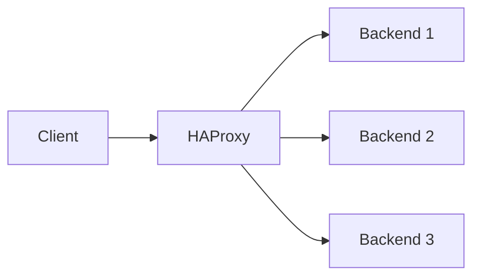
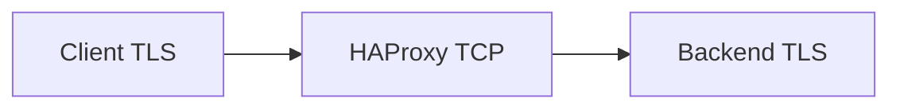
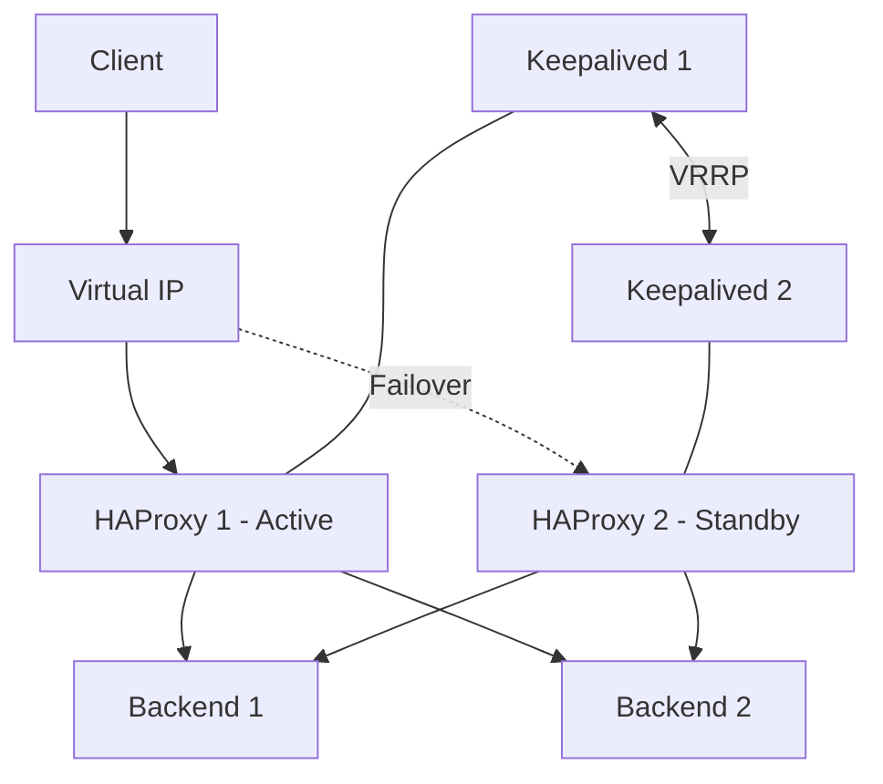
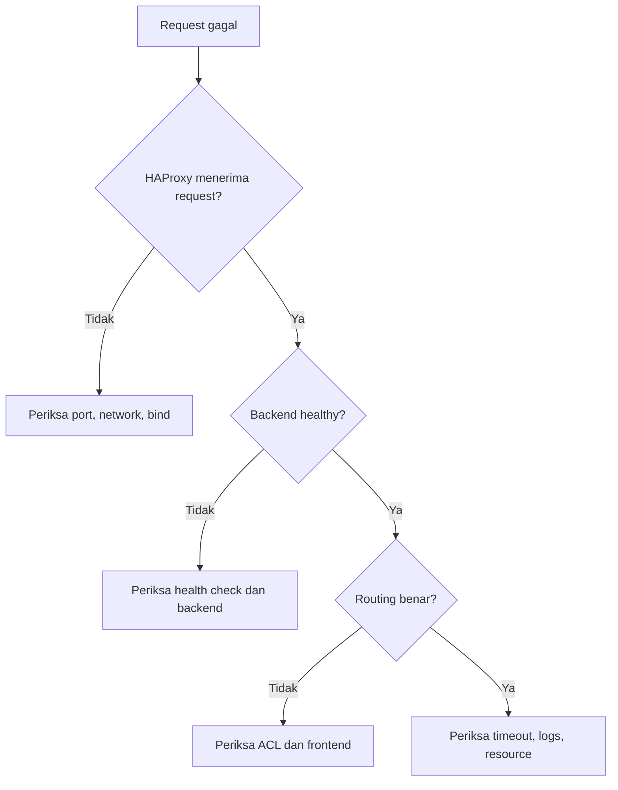
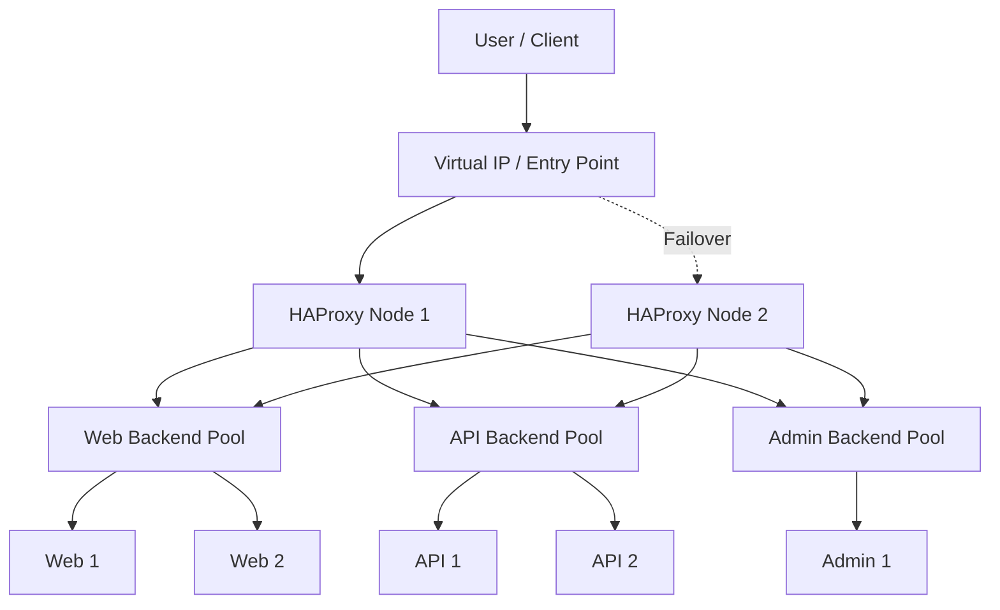

# Roadmap Belajar HAProxy dari 0 sampai Mahir
## High Availability Proxy dengan Simulasi Podman

> Roadmap berbasis praktik untuk mempelajari HAProxy dari dasar hingga mampu merancang, mengonfigurasi, menguji, dan melakukan troubleshooting load balancer serta high availability secara mandiri.

---

## 🎯 Tujuan Pembelajaran

Setelah menyelesaikan roadmap ini, peserta diharapkan mampu:

- Memahami peran proxy, reverse proxy, load balancer, dan HAProxy.
- Menjalankan HAProxy menggunakan Podman.
- Membaca dan menyusun konfigurasi HAProxy.
- Mengimplementasikan berbagai algoritma load balancing.
- Mengatur health check dan menguji kegagalan backend.
- Membuat routing berdasarkan hostname, path, header, dan ACL.
- Mengimplementasikan TLS termination dan HTTPS.
- Mengelola statistik dan monitoring HAProxy.
- Mengimplementasikan high availability dengan dua HAProxy dan VIP menggunakan Keepalived.
- Melakukan troubleshooting, tuning, hardening, dan simulasi deployment production.

---

## 🧭 Peta Perjalanan

| Level | Fokus | Hasil Praktik |
|---|---|---|
| 0 | Persiapan lingkungan | Podman siap digunakan |
| 1 | Konsep jaringan & proxy | Memahami alur request |
| 2 | HAProxy dasar | Reverse proxy pertama |
| 3 | Load balancing | Request dibagi ke beberapa backend |
| 4 | Health check & resilience | Backend gagal otomatis dikeluarkan |
| 5 | ACL & routing | Routing berdasarkan host/path/header |
| 6 | TLS & keamanan | HTTPS dan TLS termination |
| 7 | Monitoring & observability | Dashboard statistik dan metrik |
| 8 | High Availability | Dua HAProxy dengan failover VIP |
| 9 | Performance & tuning | Benchmark dan optimasi |
| 10 | Production & troubleshooting | Deployment yang siap operasional |
| Capstone | Proyek akhir | Arsitektur HAProxy multi-service |

---

# Level 0 — Persiapan Environment

## 0.1 Prasyarat

### Pengetahuan dasar

- [ ] Memahami Linux command line.
- [ ] Memahami IP address, port, DNS, TCP, dan UDP.
- [ ] Memahami HTTP request dan response.
- [ ] Mengenal konsep container.
- [ ] Familiar dengan YAML dan file konfigurasi.

Tidak perlu menguasai networking secara mendalam terlebih dahulu. Konsep yang belum dipahami akan dipelajari sambil praktik.

### Tools

- [ ] Podman
- [ ] Podman Compose (provider compose yang tersedia pada sistem)
- [ ] curl
- [ ] wget
- [ ] openssl
- [ ] Git
- [ ] Text editor / Neovim / VS Code

> Perintah dalam roadmap menggunakan `podman`. Pada beberapa sistem, perintah compose dijalankan sebagai `podman compose` dan membutuhkan provider Compose yang terpasang.

## 0.2 Verifikasi Podman

```bash
podman --version
podman info
podman ps
podman network ls
```

Jika menggunakan Podman Machine (misalnya macOS):

```bash
podman machine list
podman machine start
```

## 0.3 Buat workspace

```bash
mkdir -p haproxy-lab/{haproxy,backend,certs,logs}
cd haproxy-lab
```

Struktur awal:

```text
haproxy-lab/
├── haproxy/
│   └── haproxy.cfg
├── backend/
├── certs/
├── logs/
└── compose.yaml
```

### Lab 0 — Mengenal container dan network

```bash
podman run --rm docker.io/library/alpine:latest echo "Podman ready"
```

Buat network:

```bash
podman network create haproxy-lab
podman network ls
```

Eksplorasi:

```bash
podman images
podman ps -a
podman inspect <container>
podman logs <container>
podman exec -it <container> sh
podman stop <container>
podman rm <container>
```

**Checkpoint:** mampu menjalankan, memeriksa, menghentikan, dan menghapus container serta memahami network container.

---

# Level 1 — Fundamental Proxy dan Load Balancing

## 1.1 Konsep inti

Pelajari:

- [ ] Client dan server.
- [ ] Request-response HTTP.
- [ ] TCP handshake secara konseptual.
- [ ] Port dan socket.
- [ ] Forward proxy vs reverse proxy.
- [ ] Load balancer.
- [ ] Layer 4 (TCP) vs Layer 7 (HTTP).
- [ ] Single point of failure (SPOF).
- [ ] Availability dan redundancy.
- [ ] Health check.
- [ ] Failover dan failback.
- [ ] Session persistence.

## 1.2 Peran HAProxy

HAProxy dapat berfungsi sebagai:

- TCP proxy.
- HTTP reverse proxy.
- Load balancer.
- TLS termination point.
- Traffic router.
- Health checker.
- Komponen high availability.

## 1.3 Alur request



Request tidak selalu diteruskan ke backend yang sama. HAProxy menentukan backend berdasarkan konfigurasi, algoritma load balancing, kondisi backend, serta aturan routing.

## 1.4 Kenali komponen konfigurasi

HAProxy configuration umumnya terdiri dari:

- `global` — konfigurasi global dan proses.
- `defaults` — default untuk proxy sections.
- `frontend` — titik masuk traffic.
- `backend` — kumpulan server tujuan.
- `listen` — frontend dan backend dalam satu section, sering digunakan untuk stats listener.

**Checkpoint:** mampu menjelaskan perbedaan frontend, backend, dan server serta menggambarkan request flow.

---

# Level 2 — Instalasi HAProxy dan Reverse Proxy Pertama

## 2.1 Jalankan backend sederhana

Gunakan container web sederhana sebagai target:

```bash
podman run -d \
  --name web1 \
  --network haproxy-lab \
  docker.io/library/nginx:alpine
```

Uji:

```bash
podman ps
podman exec web1 nginx -v
```

## 2.2 Jalankan HAProxy

Buat file `haproxy/haproxy.cfg`:

```cfg
global
    log stdout format raw local0
    maxconn 2000

defaults
    log global
    mode http
    option httplog
    timeout connect 5s
    timeout client 30s
    timeout server 30s

frontend http_front
    bind :80
    default_backend web_servers

backend web_servers
    server web1 web1:80 check
```

Jalankan container HAProxy:

```bash
podman run -d \
  --name haproxy \
  --network haproxy-lab \
  -p 8080:80 \
  -v ./haproxy/haproxy.cfg:/usr/local/etc/haproxy/haproxy.cfg:ro \
  docker.io/library/haproxy:alpine
```

Uji:

```bash
curl -i http://localhost:8080
podman logs haproxy
```

## 2.3 Pelajari directive

- `global`
- `defaults`
- `frontend`
- `backend`
- `bind`
- `default_backend`
- `server`
- `mode http`
- `mode tcp`
- `option httplog`
- `timeout connect`
- `timeout client`
- `timeout server`

## Lab 2 — Reverse proxy

- [ ] Client mengakses port 8080.
- [ ] HAProxy menerima traffic pada port 80 container.
- [ ] HAProxy meneruskan request ke web1.
- [ ] Backend tidak harus dipublikasikan ke host.
- [ ] Periksa log request.
- [ ] Matikan web1 lalu amati respons HAProxy.

**Checkpoint:** mampu menjelaskan alur client → HAProxy → backend.

---

# Level 3 — Load Balancing

## 3.1 Tambahkan backend server

Buat beberapa web server dengan halaman identitas berbeda.

Contoh menggunakan container Nginx:

```bash
podman run -d --name web1 --network haproxy-lab nginx:alpine
podman run -d --name web2 --network haproxy-lab nginx:alpine
podman run -d --name web3 --network haproxy-lab nginx:alpine
```

Agar hasil mudah diamati, mount masing-masing HTML berbeda atau gunakan image web sederhana yang menampilkan hostname.

## 3.2 Konfigurasi backend

```cfg
backend web_servers
    balance roundrobin
    server web1 web1:80 check
    server web2 web2:80 check
    server web3 web3:80 check
```

## 3.3 Algoritma load balancing

Pelajari dan praktikkan:

### Round Robin

```cfg
balance roundrobin
```

Request dibagikan secara bergiliran ke server yang tersedia.

### Least Connections

```cfg
balance leastconn
```

Request diarahkan ke server dengan koneksi aktif paling sedikit.

### Static Round Robin

```cfg
balance static-rr
```

Pembagian menggunakan urutan statis dengan memperhatikan weight.

### Source

```cfg
balance source
```

Pemilihan backend didasarkan pada hash alamat sumber. Pelajari konsekuensi NAT dan distribusi yang tidak merata.

### Weight

```cfg
server web1 web1:80 check weight 5
server web2 web2:80 check weight 2
server web3 web3:80 check weight 1
```

Server dengan weight lebih tinggi menerima porsi traffic lebih besar pada algoritma yang mendukung weight.

## Lab 3 — Mengamati distribusi

```bash
for i in $(seq 1 20); do
  curl -s http://localhost:8080
done
```

Eksperimen:

- [ ] Round Robin.
- [ ] Least Connections.
- [ ] Source.
- [ ] Ubah weight.
- [ ] Simulasikan backend dengan respons lebih lambat.
- [ ] Bandingkan distribusi request.
- [ ] Jelaskan mengapa distribusi tidak selalu sama persis.

**Checkpoint:** mampu memilih algoritma sesuai karakteristik workload.

---

# Level 4 — Health Check dan Resilience

## 4.1 Health check dasar

```cfg
backend web_servers
    balance roundrobin
    option httpchk GET /
    server web1 web1:80 check
    server web2 web2:80 check
```

Pelajari:

- [ ] TCP health check.
- [ ] HTTP health check.
- [ ] HTTP status code yang dianggap sehat.
- [ ] Interval health check.
- [ ] Rise dan fall.
- [ ] Check port.
- [ ] Check URI.
- [ ] Check inter.
- [ ] Check fall.
- [ ] Check rise.

Contoh:

```cfg
server web1 web1:80 check inter 2s fall 3 rise 2
```

Artinya secara konseptual: check dilakukan berkala; backend akan dinyatakan down setelah sejumlah kegagalan berturut-turut dan kembali up setelah sejumlah keberhasilan.

## 4.2 HTTP check dengan status tertentu

```cfg
backend web_servers
    option httpchk GET /health
    http-check expect status 200
    server web1 web1:80 check
    server web2 web2:80 check
```

> Endpoint health check sebaiknya merepresentasikan kesiapan service, bukan sekadar halaman yang selalu tersedia.

## Lab 4 — Simulasi backend down

1. Jalankan 3 backend.
2. Pastikan semua backend sehat.
3. Hentikan salah satu backend:

```bash
podman stop web2
```

4. Amati status backend melalui log atau stats.
5. Kirim request berkali-kali.
6. Pastikan backend yang down tidak menerima traffic baru.
7. Hidupkan kembali:

```bash
podman start web2
```

8. Amati proses backend kembali healthy.

**Checkpoint:** mampu memahami dan menguji deteksi kegagalan serta pemulihan backend.

---

# Level 5 — ACL, Routing, dan Traffic Management

## 5.1 ACL dasar

ACL digunakan untuk mengambil keputusan routing atau aturan traffic.

Pelajari:

- [ ] `acl`
- [ ] `use_backend`
- [ ] `http-request`
- [ ] `http-response`
- [ ] `deny`
- [ ] `redirect`
- [ ] `set-header`
- [ ] `add-header`
- [ ] `del-header`

## 5.2 Routing berdasarkan hostname

```cfg
frontend http_front
    bind :80

    acl host_app1 hdr(host) -i app1.local
    acl host_app2 hdr(host) -i app2.local

    use_backend app1_servers if host_app1
    use_backend app2_servers if host_app2

    default_backend default_servers
```

## 5.3 Routing berdasarkan path

```cfg
frontend http_front
    bind :80

    acl path_api path_beg /api
    acl path_admin path_beg /admin

    use_backend api_servers if path_api
    use_backend admin_servers if path_admin

    default_backend web_servers
```

## 5.4 Routing berdasarkan header

Contoh aturan berdasarkan header:

```cfg
frontend http_front
    bind :80

    acl mobile_client hdr_sub(User-Agent) -i mobile
    use_backend mobile_servers if mobile_client

    default_backend web_servers
```

## 5.5 Redirect HTTP

```cfg
frontend http_front
    bind :80

    http-request redirect scheme https code 301 if !{ ssl_fc }
```

## 5.6 Manipulasi header

Pelajari penggunaan header untuk:

- Identitas client.
- Forwarded information.
- Security headers.
- Debugging.
- Routing internal.

**Checkpoint:** mampu membuat routing multi-application berdasarkan hostname, path, dan header.

---

# Level 6 — TLS / HTTPS dan Security

## 6.1 Konsep TLS

Pelajari:

- [ ] TLS handshake.
- [ ] Certificate.
- [ ] Private key.
- [ ] CA.
- [ ] Certificate chain.
- [ ] SNI.
- [ ] TLS termination.
- [ ] TLS passthrough.
- [ ] Backend TLS.
- [ ] HTTP vs HTTPS.
- [ ] TLS version dan cipher secara konseptual.

## 6.2 Membuat sertifikat lab

Untuk simulasi lokal, buat self-signed certificate:

```bash
mkdir -p certs

openssl req -x509 -newkey rsa:2048 \
  -keyout certs/lab.key \
  -out certs/lab.crt \
  -days 365 \
  -nodes \
  -subj "/CN=localhost"
```

Gabungkan certificate dan key:

```bash
cat certs/lab.crt certs/lab.key > certs/lab.pem
```

> Sertifikat self-signed hanya untuk lab. Production sebaiknya menggunakan certificate dari CA tepercaya dan pengelolaan renewal yang benar.

## 6.3 HTTPS frontend

```cfg
frontend https_front
    bind :443 ssl crt /usr/local/etc/haproxy/certs/lab.pem
    default_backend web_servers
```

Mount file certificate ke container HAProxy dan publish port HTTPS ke host.

## 6.4 TLS termination


HAProxy menerima koneksi HTTPS, melakukan dekripsi, lalu meneruskan request ke backend menggunakan HTTP.

## 6.5 TLS passthrough



HAProxy meneruskan koneksi TLS tanpa melakukan dekripsi. Pelajari kapan mode TCP diperlukan.

## 6.6 Security checklist

- [ ] Batasi versi TLS yang digunakan.
- [ ] Gunakan certificate yang valid.
- [ ] Lindungi private key.
- [ ] Jangan expose stats tanpa autentikasi.
- [ ] Batasi akses ke admin endpoint.
- [ ] Terapkan timeout.
- [ ] Evaluasi batas koneksi.
- [ ] Hindari logging informasi sensitif.
- [ ] Evaluasi header security.
- [ ] Pertimbangkan rate limiting sesuai kebutuhan.
- [ ] Pahami trust chain saat HAProxy berkomunikasi dengan backend HTTPS.

**Checkpoint:** mampu mengonfigurasi HTTPS frontend dan menjelaskan TLS termination vs passthrough.

---

# Level 7 — Monitoring, Logging, dan Observability

## 7.1 Logging

```cfg
global
    log stdout format raw local0

defaults
    log global
    option httplog
```

Pelajari informasi log:

- Waktu request.
- Client.
- Frontend.
- Backend.
- Server yang dipilih.
- HTTP status.
- Durasi request.
- Jumlah byte.
- Informasi termination state.

## 7.2 Stats page

Contoh konfigurasi lab:

```cfg
listen stats
    bind :8404
    mode http
    stats enable
    stats uri /stats
    stats refresh 5s
```

Akses:

```text
http://localhost:8404/stats
```

Untuk penggunaan selain lab, jangan membiarkan halaman statistik terbuka tanpa pembatasan akses dan autentikasi.

## 7.3 Monitoring yang perlu dipahami

- [ ] Active sessions.
- [ ] Current connections.
- [ ] Max connections.
- [ ] Queue.
- [ ] Backend status.
- [ ] Server status.
- [ ] Request rate.
- [ ] Response time.
- [ ] Error rate.
- [ ] Bytes in/out.
- [ ] Health check failure.
- [ ] Saturation.

## 7.4 Observability

Pelajari integrasi atau pendekatan:

- HAProxy stats.
- Prometheus exporter.
- Grafana dashboard.
- Centralized logging.
- Alerting.
- Log rotation.

**Checkpoint:** mampu mengidentifikasi backend down, koneksi tinggi, antrean, dan error dari metrics/log.

---

# Level 8 — High Availability dengan Dua HAProxy

## 8.1 Konsep High Availability

Pelajari:

- [ ] Active-passive.
- [ ] Active-active.
- [ ] Virtual IP (VIP).
- [ ] Failover.
- [ ] Keepalived.
- [ ] VRRP.
- [ ] Health monitoring.
- [ ] Split brain secara konseptual.
- [ ] Failback.
- [ ] Availability vs reliability.

## 8.2 Arsitektur lab



## 8.3 Implementasi simulasi

Buat lab dengan:

- [ ] HAProxy 1.
- [ ] HAProxy 2.
- [ ] Keepalived 1.
- [ ] Keepalived 2.
- [ ] Backend web 1 dan 2.
- [ ] Network Podman yang sesuai.

Perhatikan keterbatasan network/container di lingkungan Podman, terutama dukungan VIP, multicast VRRP, dan konfigurasi host networking. Pada macOS, Podman berjalan di VM sehingga simulasi VIP mungkin memerlukan pendekatan network khusus atau VM Linux.

## 8.4 Skenario failover

1. Pastikan HAProxy 1 menjadi MASTER.
2. Pastikan VIP aktif pada node pertama.
3. Akses service menggunakan VIP.
4. Matikan HAProxy 1.
5. Amati VIP berpindah ke HAProxy 2.
6. Uji request selama failover.
7. Hidupkan HAProxy 1 kembali.
8. Amati perilaku failback sesuai konfigurasi priority/preemption.

**Checkpoint:** mampu menjelaskan dan menguji failover proxy node, bukan hanya failover backend.

---

# Level 9 — Performance, Capacity, dan Tuning

## 9.1 Connection management

Pelajari:

- [ ] `maxconn`
- [ ] `timeout connect`
- [ ] `timeout client`
- [ ] `timeout server`
- [ ] Keep-alive.
- [ ] Connection reuse.
- [ ] Queue.
- [ ] Backlog.
- [ ] File descriptor.
- [ ] OS limits.
- [ ] CPU dan memory.
- [ ] Network throughput.

## 9.2 Benchmark

Gunakan tools seperti:

- `wrk`
- `ab` (ApacheBench)
- `hey`

Contoh benchmark dengan `wrk`:

```bash
wrk -t4 -c100 -d30s http://localhost:8080/
```

Catat:

- Requests per second.
- Latency.
- P95 / P99 (jika tool mendukung).
- Error.
- CPU HAProxy.
- CPU backend.
- Jumlah koneksi.
- Perbandingan saat satu backend vs beberapa backend.

## 9.3 Eksperimen tuning

- [ ] Ubah `maxconn`.
- [ ] Ubah timeout.
- [ ] Ubah jumlah backend.
- [ ] Simulasikan backend lambat.
- [ ] Simulasikan backend overload.
- [ ] Bandingkan roundrobin dan leastconn.
- [ ] Benchmark HTTP dan TCP.
- [ ] Amati queue.
- [ ] Identifikasi bottleneck.
- [ ] Dokumentasikan hasil sebelum/sesudah.

> Hindari menyalin angka tuning dari internet secara langsung. Parameter harus disesuaikan dengan workload, resource, latency, dan hasil pengukuran.

**Checkpoint:** mampu melakukan benchmark terukur dan menjelaskan perubahan performa berdasarkan hasil eksperimen.

---

# Level 10 — Advanced Configuration dan Operasional

## 10.1 Advanced routing

Pelajari:

- [ ] ACL kompleks.
- [ ] Regex matching.
- [ ] Map files.
- [ ] Dynamic routing.
- [ ] Multiple frontend.
- [ ] Multiple backend.
- [ ] TCP content inspection.
- [ ] SNI routing.
- [ ] HTTP/2.
- [ ] WebSocket.
- [ ] gRPC (tergantung versi dan konfigurasi).
- [ ] IPv4 dan IPv6.

## 10.2 Persistence dan session

Pelajari:

- [ ] Cookie-based persistence.
- [ ] Stick tables.
- [ ] Source-based persistence.
- [ ] Sticky session.
- [ ] Kapan persistence diperlukan.
- [ ] Konsekuensi persistence terhadap distribusi load.
- [ ] Stateless application architecture.

## 10.3 Rate limiting dan abuse protection

Pelajari secara konseptual dan praktik:

- [ ] Stick tables.
- [ ] Tracking client.
- [ ] Rate limit per IP.
- [ ] Request flood.
- [ ] Connection limits.
- [ ] Deny rules.
- [ ] ACL untuk membatasi traffic.
- [ ] Perbedaan rate limit di proxy dan di aplikasi.

## 10.4 Runtime API dan reload

Pelajari:

- [ ] Runtime API.
- [ ] Socket admin.
- [ ] Melihat status server.
- [ ] Mengubah status server.
- [ ] Disable/enable backend.
- [ ] Soft stop.
- [ ] Graceful reload.
- [ ] Validasi konfigurasi sebelum reload.

Validasi konfigurasi:

```bash
podman exec haproxy haproxy -c -f /usr/local/etc/haproxy/haproxy.cfg
```

## 10.5 Deployment strategy

Pelajari:

- [ ] Version control konfigurasi.
- [ ] Environment separation.
- [ ] Template config.
- [ ] Secret management.
- [ ] Config validation.
- [ ] Rolling update.
- [ ] Graceful reload.
- [ ] Rollback.
- [ ] Backup.
- [ ] Change management.

**Checkpoint:** mampu merancang workflow perubahan konfigurasi HAProxy yang aman dan dapat di-rollback.

---

# Level 11 — Troubleshooting dan Production Readiness

## 11.1 Masalah yang umum

### HAProxy tidak start

Periksa:

```bash
podman logs haproxy
```

Validasi konfigurasi:

```bash
podman exec haproxy haproxy -c -f /usr/local/etc/haproxy/haproxy.cfg
```

Penyebab umum:

- Syntax error.
- Port conflict.
- File certificate tidak ditemukan.
- Permission.
- Config mount salah.
- Directive tidak sesuai versi.

### Backend DOWN

Periksa:

- DNS/container name.
- Network Podman.
- Port backend.
- Service backend.
- Health check URI.
- Status code.
- Timeout.
- Firewall.

### 503 Service Unavailable

Kemungkinan:

- Semua backend down.
- Backend tidak terdaftar.
- Health check gagal.
- ACL mengarah ke backend yang tidak memiliki server sehat.
- Queue atau batas koneksi.

### Request timeout

Periksa:

- `timeout connect`.
- `timeout client`.
- `timeout server`.
- Backend lambat.
- Network.
- Resource utilization.

### Traffic tidak terbagi merata

Periksa:

- Algoritma.
- Weight.
- Session persistence.
- Jumlah koneksi.
- Request duration.
- Health status.
- Client behavior.

## 11.2 Troubleshooting workflow



## 11.3 Production readiness checklist

- [ ] Konfigurasi tervalidasi.
- [ ] Timeout sesuai workload.
- [ ] Health check sesuai aplikasi.
- [ ] Backend redundancy.
- [ ] HAProxy redundancy.
- [ ] TLS certificate valid.
- [ ] Private key aman.
- [ ] Stats endpoint dibatasi.
- [ ] Logging terintegrasi.
- [ ] Metrics dan alerting.
- [ ] Resource limit ditinjau.
- [ ] Connection limit ditinjau.
- [ ] Graceful reload diuji.
- [ ] Failover diuji.
- [ ] Backup konfigurasi.
- [ ] Rollback tersedia.
- [ ] Dokumentasi arsitektur.
- [ ] Runbook troubleshooting.

---

# 🏆 Capstone Project — Multi-Service High Availability Proxy

## Skenario

Bangun arsitektur simulasi dengan HAProxy sebagai entry point untuk beberapa aplikasi.

### Arsitektur



## Requirement

### Infrastruktur

- [ ] Semua komponen berjalan menggunakan Podman.
- [ ] Network terpisah atau dirancang dengan jelas.
- [ ] Dua node HAProxy.
- [ ] Backend web minimal dua instance.
- [ ] Backend API minimal dua instance.
- [ ] Backend admin minimal satu instance.
- [ ] Implementasi high availability proxy (jika lingkungan lab mendukung VIP/VRRP).

### Routing

- [ ] `web.lab.local` → web backend.
- [ ] `api.lab.local` → API backend.
- [ ] `admin.lab.local` → admin backend.
- [ ] `/api` dapat diarahkan sesuai skenario alternatif.
- [ ] Default backend tersedia.

### Load balancing

- [ ] Web pool menggunakan roundrobin.
- [ ] API pool menggunakan leastconn.
- [ ] Weight dapat diubah.
- [ ] Backend down otomatis dikeluarkan.

### Security

- [ ] HTTPS frontend.
- [ ] TLS termination.
- [ ] HTTP redirect ke HTTPS.
- [ ] Admin/stats endpoint dibatasi.
- [ ] Header yang relevan dikonfigurasi.

### Monitoring

- [ ] Stats page.
- [ ] Logs.
- [ ] Health status.
- [ ] Request distribution.
- [ ] Failover event.

### Testing

- [ ] Normal traffic.
- [ ] Backend failure.
- [ ] Backend recovery.
- [ ] HAProxy node failure.
- [ ] TLS test.
- [ ] Routing test.
- [ ] Load test.
- [ ] Configuration reload.
- [ ] Rollback.

## Deliverables

- [ ] Repository Git.
- [ ] `compose.yaml` atau script Podman.
- [ ] Konfigurasi HAProxy.
- [ ] Konfigurasi backend.
- [ ] Certificate lab.
- [ ] Diagram arsitektur.
- [ ] README setup.
- [ ] Test plan.
- [ ] Hasil benchmark.
- [ ] Dokumentasi failover.
- [ ] Troubleshooting guide.

---

# 🗓️ Rencana Belajar 6 Minggu

| Minggu | Materi | Praktik |
|---|---|---|
| 1 | Networking, proxy, Podman | Menyiapkan lab dan reverse proxy |
| 2 | HAProxy config & load balancing | 3 backend + algoritma |
| 3 | Health check & ACL | Failover backend dan routing |
| 4 | TLS & monitoring | HTTPS, stats, logs |
| 5 | HA & performance | Dua proxy, benchmark, failover |
| 6 | Advanced & capstone | Multi-service HA architecture |

> Jadwal fleksibel. Jika konsep networking masih baru, alokasikan waktu tambahan untuk minggu pertama.

---

# 📚 Referensi Belajar

- Official HAProxy documentation: https://www.haproxy.org/
- HAProxy Configuration Manual: https://docs.haproxy.org/
- Podman documentation: https://docs.podman.io/
- Keepalived documentation: https://www.keepalived.org/
- OpenSSL documentation: https://www.openssl.org/docs/

Utamakan dokumentasi sesuai versi HAProxy yang digunakan, karena beberapa directive dan fitur dapat berbeda antarversi.

---

# ✅ Checklist Kompetensi Akhir

## Fundamental

- [ ] Memahami reverse proxy.
- [ ] Memahami load balancer.
- [ ] Memahami Layer 4 vs Layer 7.
- [ ] Memahami frontend, backend, dan server.

## Configuration

- [ ] Menulis konfigurasi HAProxy.
- [ ] Menggunakan frontend dan backend.
- [ ] Mengatur timeout.
- [ ] Mengatur logging.
- [ ] Validasi config.

## Traffic

- [ ] Roundrobin.
- [ ] Leastconn.
- [ ] Weight.
- [ ] ACL.
- [ ] Host routing.
- [ ] Path routing.
- [ ] Header routing.

## Resilience

- [ ] TCP health check.
- [ ] HTTP health check.
- [ ] Backend failure.
- [ ] Recovery.
- [ ] Graceful reload.

## Security

- [ ] TLS termination.
- [ ] HTTPS redirect.
- [ ] Certificate management.
- [ ] Stats access control.
- [ ] Security hardening dasar.

## Operations

- [ ] Logs.
- [ ] Stats.
- [ ] Metrics.
- [ ] Benchmark.
- [ ] Troubleshooting.
- [ ] Rollback.

## High Availability

- [ ] Memahami active-passive.
- [ ] Memahami VIP.
- [ ] Memahami VRRP.
- [ ] Menguji failover.
- [ ] Menyusun runbook.

---

## 🎓 Indikator “Mahir”

Anda dapat dikategorikan mahir dalam HAProxy ketika mampu:

1. Merancang arsitektur proxy berdasarkan kebutuhan aplikasi.
2. Menentukan mode TCP atau HTTP dengan alasan yang tepat.
3. Membuat routing kompleks tanpa konfigurasi yang sulit dipelihara.
4. Mengimplementasikan backend health check yang benar.
5. Mengelola HTTPS, certificate, dan TLS policy.
6. Menangani backend failure dan proxy failure.
7. Menganalisis logs, metrics, dan performa.
8. Melakukan benchmark dan tuning berbasis data.
9. Menyusun konfigurasi yang aman, ter-version-control, dan dapat di-rollback.
10. Menjelaskan trade-off load balancing, persistence, failover, dan availability.

---

> **Saran belajar:** Jangan hanya membaca directive HAProxy. Untuk setiap fitur, ubah konfigurasi, jalankan traffic, matikan salah satu komponen, amati log dan stats, lalu dokumentasikan hasilnya. Kemampuan troubleshooting dan memahami alur traffic jauh lebih penting daripada menghafal konfigurasi.
